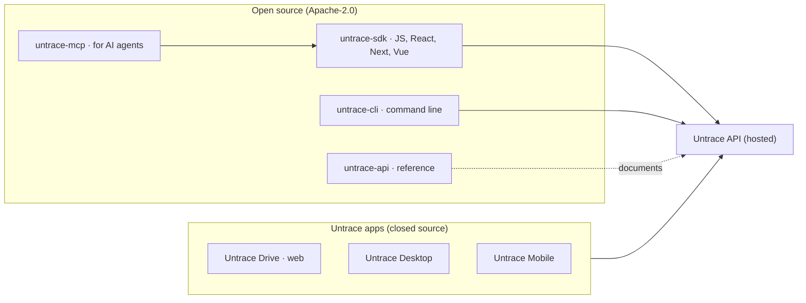

  

---

  <strong>Join <a href="https://x.com/untracenetwork">#untrace.builders</a></strong> are the open source crew making sensitive data harder to steal, easier to prove, and safer to use.

---

## Introduction

Every data breach in history shared one architectural characteristic: the data existed in one place. Firewalls, encryption-at-rest, intrusion detection systems, and AI-powered SOC teams all operate under the assumption that data will be stored centrally and that security means defending that central location.

This model has failed systematically. The asymmetry is structural: attackers only need one path into the target, while defenders must secure every path forever.

## How Untrace is built

Untrace has two kinds of software. The apps are closed. Everything a developer builds on is open.

| Repo | What it is | Status |
|---|---|---|
| [untrace-desktop](https://github.com/untracenetwork/untrace-desktop) | Download page for the desktop app (macOS, Windows, Linux), signed builds | Live |
| [untrace-mobile](https://github.com/untracenetwork/untrace-mobile) | Mobile app | In progress |
| untrace-api | API reference | Coming |
| untrace-sdk | Client libraries for the API | Coming |
| untrace-mcp | MCP server, so AI agents can use your files with your permission | Coming |
| untrace-cli | Command-line client for the API | Coming |

### Signing in

- **Developers and companies** connect with a client ID and client secret, server to server. You own your tenant and your users.
- **People using our apps** sign in with a passkey.

### Access to files and folders

- A folder or file can hold several keys: a person's passkey, an app's client credential, a device key.
- A key can open a whole folder, one subfolder or a single file.
- To share, the other person adds **their own** key under **their own** username. Nobody hands a key over.
- Untrace stores files across 6 independent regions; any 3 recover a file.

### Enterprise

Self-hosted and private-cloud installs are delivered by Untrace directly, never from these public repos. Contact contact@untrace.network.

## What We Are Building

| Layer            | Builder Playground                                                                    |
| ---------------- | ------------------------------------------------------------------------------------- |
| Storage protocol | Encryption, Shamir key shares, erasure-coded payload shards, signed delivery receipts |
| Node network     | Rust storage nodes, availability checks, node identity, retrieval verification        |
| Access policy    | Wallet signatures, grants, revocations, policy registries, audit receipts             |
| Proof workflows  | Noir circuits, Barretenberg benchmarks, document-derived attestations                 |
| Apps             | Private vaults, bank statement proofs, SBT attestations, eSignatures, USDT escrow     |

## Come Build With Us

We are looking for open source collaborators who like hard problems with clean interfaces:

- Rust engineers who want to shape the shard node runtime.
- Cryptography and ZK builders who enjoy proving useful facts without leaking the document.
- Wallet, identity, and smart contract devs who care about access control at the edge.
- Frontend builders who can turn private vault workflows into fast, calm product experiences.
- Security reviewers who like threat models, uncomfortable questions, and public design critique.
- Community operators, educators, and hackathon leads who can help builders run the demo and explain the architecture.

## Good First Shards

If you want a first contribution, start small and useful:

- Improve diagrams and explainers for client-side encryption, key sharing, and shard recovery.
- Add docs for the local 3-of-5 vault demo and expected failure cases.
- Write test vectors for manifest commitments, signed retrieval requests, and shard reconstruction.
- Benchmark Noir and Barretenberg proof flows for document-derived claims.
- Build example integrations for wallets, dashboards, or private file workflows.
- Open security notes when an assumption feels too magical.

## Launch Trail

| Milestone               | Why It Matters                                                   |
| ----------------------- | ---------------------------------------------------------------- |
| Protocol spec freeze    | Public architecture for review and contributor trust             |
| Local 3-of-5 vault demo | Recover a file without ever storing the full object in one place |
| Private technical beta  | Design partners test wallet-gated shard retrieval                |
| Network launch          | Developers write and retrieve private vaults                     |
| Vault dashboard         | Private document workflows for teams                             |
| DID and eSignatures     | Wallet-native signing for private documents                      |
| USDT escrow             | Private documents connected to settlement                        |

## Join The Signal

Bring a demo, a question, a benchmark, a critique, or a weirdly specific integration idea. Open an issue, propose a small PR, or start a discussion around the piece you want to build.

Read the contributor guide: [CONTRIBUTING.md](../CONTRIBUTING.md)

Related: [untrace-cli](https://github.com/untracenetwork/untrace-cli), the Untrace CLI and Desktop app (macOS, Windows, Linux).

  <strong>Make the breach meaningless.</strong> 
  <strong>Join <a href="https://x.com/untracenetwork">#untrace.builders</a></strong>

