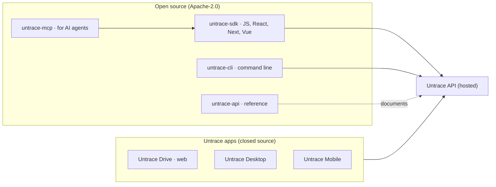

  

---

  <strong>Join <a href="https://x.com/untracenetwork">#untrace.builders</a></strong> are the open source crew making sensitive data harder to steal, easier to prove, and safer to use.

---

## Introduction

Every data breach in history shared one architectural characteristic: the data existed in one place. Firewalls, encryption-at-rest, intrusion detection systems, and AI-powered SOC teams all operate under the assumption that data will be stored centrally and that security means defending that central location.

This model has failed systematically. The asymmetry is structural: attackers only need one path into the target, while defenders must secure every path forever.

## How Untrace is built

Untrace has two kinds of software. The apps are closed. Everything a developer builds on is open.

| Repo | What it is | Status |
|---|---|---|
| [untrace-desktop](https://github.com/untracenetwork/untrace-desktop) | Download page for the desktop app (macOS, Windows, Linux), signed builds | Live |
| [untrace-mobile](https://github.com/untracenetwork/untrace-mobile) | Mobile app | In progress |
| untrace-api | API reference | Coming |
| untrace-sdk | Client libraries for the API | Coming |
| untrace-mcp | MCP server, so AI agents can use your files with your permission | Coming |
| untrace-cli | Command-line client for the API | Coming |

### Signing in

- **Developers and companies** connect with a client ID and client secret, server to server. You own your tenant and your users.
- **People using our apps** sign in with a passkey.

### Access to files and folders

- A folder or file can hold several keys: a person's passkey, an app's client credential, a device key.
- A key can open a whole folder, one subfolder or a single file.
- To share, the other person adds **their own** key under **their own** username. Nobody hands a key over.
- Untrace stores files across 6 independent regions; any 3 recover a file.

### Enterprise

Self-hosted and private-cloud installs are delivered by Untrace directly, never from these public repos. Contact contact@untrace.network.

## Join The Signal

Bring a demo, a question, a benchmark, a critique, or a weirdly specific integration idea. Open an issue, propose a small PR, or start a discussion around the piece you want to build.

Read the contributor guide: [CONTRIBUTING.md](../CONTRIBUTING.md)

  <strong>Make the breach meaningless.</strong> 
  <strong>Join <a href="https://x.com/untracenetwork">#untrace.builders</a></strong>

